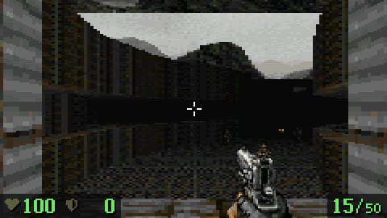
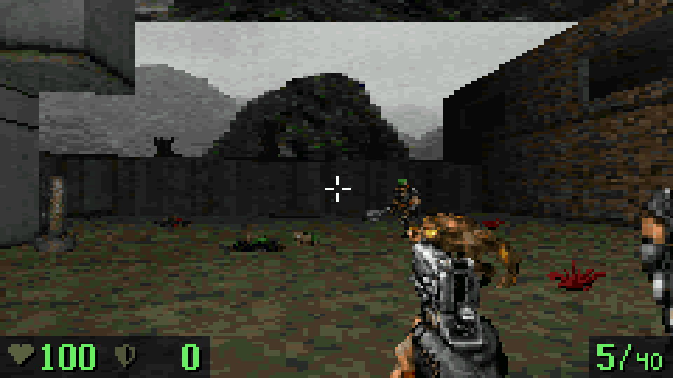
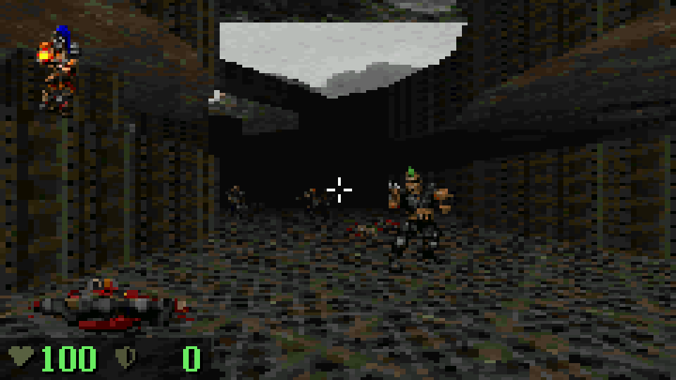
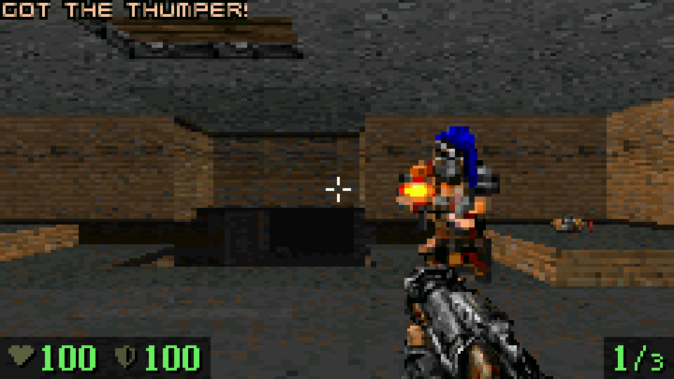
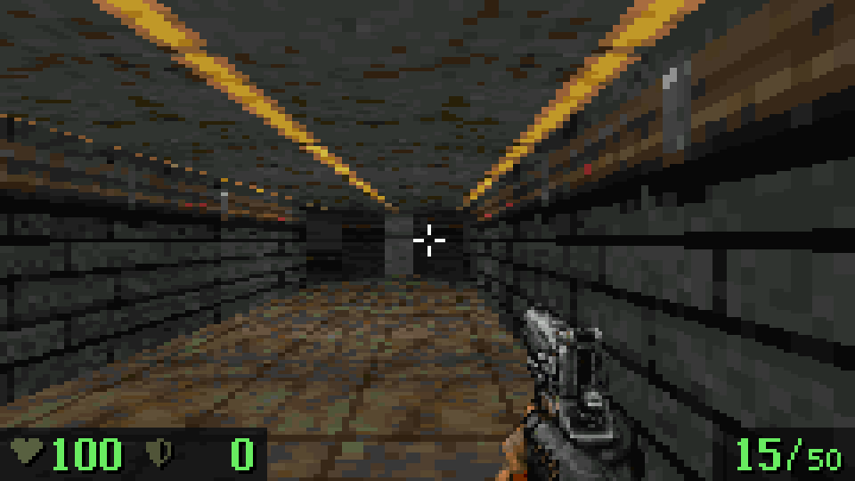
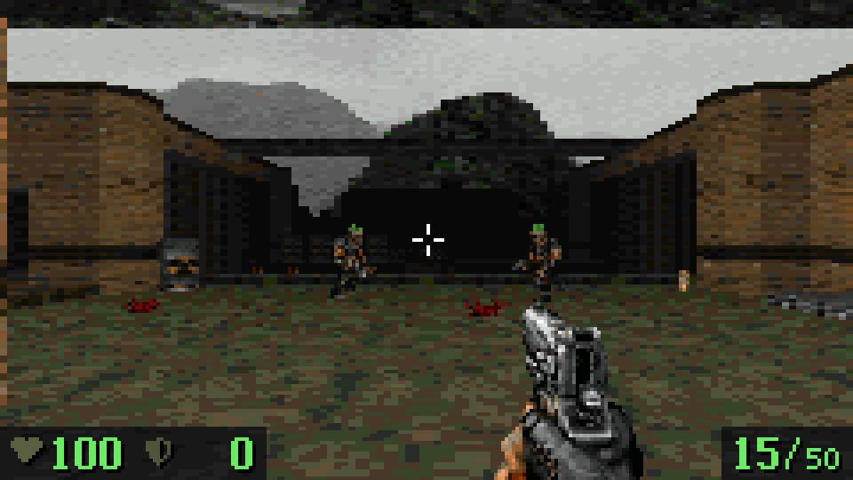
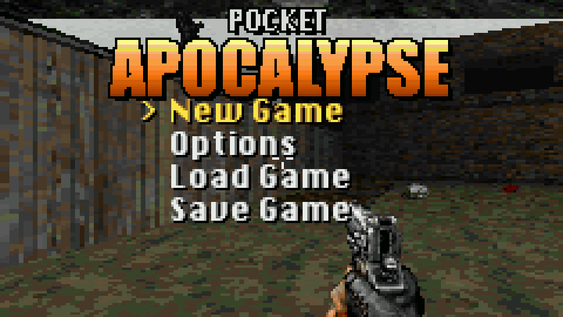
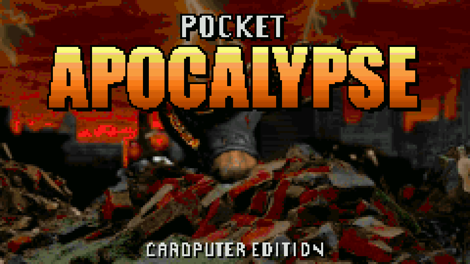

# Pocket Apocalypse, Cardputer Edition

A post-apocalyptic Doom-engine shooter for the M5Stack Cardputer ADV. It plays the
first ten levels of Erik Alm's *Scythe* with weapons, enemies, textures and props
from *Ashes 2063*. You fight human raiders and mutants with magazine-fed guns that
need reloading, and the game adds fog, gore and a full-screen overlay HUD. The
engine and all game data fit in one 5.8 MB firmware image. The game runs without
an SD card; the card only holds savegames.



[Gameplay video, MP4, 26 seconds, no sound](docs/gameplay.mp4)

| | |
|---|---|
|  |  |
|  |  |
|  |  |
|  | |

The screenshots and video come from the host simulator, `tools/host/run_sim.sh`.
With `VIDEO=1` set, the simulator saves every frame. The images show the 240×135
screen at 4× size.

> **Personal-use build.** This firmware contains game data that its authors do not
> allow anyone to redistribute. See [Licences](#licences). Do not publish it to
> public firmware catalogues as it is.

## Features

- 10 levels, Scythe MAP01 to MAP10 with the fSCYTHE fixes, and 5 skill levels.
- 13 Ashes 2063 weapons with magazines and reloads: crowbar, police pistol,
  9mm autoloader, revolver, lever-action, pump and hunter shotguns, machine
  pistol, modular rifle, military and battle rifles, Thumper grenade launcher
  and Bolt-Caster crossbow. The two rifles use their own 5.56 ammo.
- Ashes raiders, cannibals and mutants replace the Doom monsters.
- Jump, free look and a crosshair. On the Cardputer ADV you can also aim by
  tilting the device, using its gyro.
- Rebindable keys in Options › Controls and gyro settings in Options › Gyro Aim.
  The game keeps both in NVS, so they survive a power cycle.
- 8 savegame slots in `/sd/doom` on the microSD card. Without a card the game
  runs but cannot save.

## Install

Download both images from the [v1.0 release](../../releases/tag/v1.0), or
build them yourself with the steps in [Build from source](#build-from-source).
Each file name ends with the build date.

| File | Use it for | Flash offset |
|---|---|---|
| `pocket-apocalypse-cardputer-m5burner.<date>.bin` | Full image for M5Burner or esptool: bootloader, partition table and game | `0x0` |
| `pocket-apocalypse-cardputer-adv.<date>.bin` | Game only, for M5Launcher | Launcher picks it |

### Full image with M5Burner or esptool

The full image holds the bootloader, the partition table and the game, so you
write it at address `0x0`. It replaces everything on the device, M5Launcher
included.

To list it in M5Burner, log in with an M5Stack account, open USER CUSTOM ›
Publish, and give a GitHub link, the firmware file and a cover image such as
`docs/screenshots/title.png`. M5Burner shares published firmware with other
users, so read [Licences](#licences) first.

To flash it with esptool instead:

```sh
esptool.py --chip esp32s3 --port /dev/cu.usbmodem* write_flash 0x0 pocket-apocalypse-cardputer-m5burner.<date>.bin
```

### Game only with M5Launcher

Copy `pocket-apocalypse-cardputer-adv.<date>.bin` to the SD card, for example
into `/Firmware/`, and install it from Launcher's SD menu. The game takes 5.8 MB
of app space, so on an 8 MB Cardputer it is the only app that fits next to
Launcher.

## Controls

| Action | Key | | Action | Key |
|---|---|---|---|---|
| Forward, back | `;`, `.` | | Fire | `ctrl` |
| Turn left, right | `,`, `/` | | Use or open | `opt` |
| Strafe left, right | `z`, `x` | | Run while held | `shift` |
| Turn keys strafe while held | `fn` | | Jump | `space` |
| Look up, down, centre | `q`, `a`, `s` | | Reload | `r` |
| Previous, next weapon | `w`, `e` | | Automap | `tab` |
| Weapon slot, press again to cycle | `1` to `7` | | Gyro hold key | `alt` |
| Menu | `` ` `` | | Gyro on or off | `g` |
| Confirm | `enter` | | | |

The weapon slots are 1 crowbar, 2 pistols, 3 shotguns, 4 SMGs, 5 Thumper,
6 rifles and 7 Bolt-Caster. You can change every game key in Options › Controls.

## Hardware

The game was developed and tested on the M5Stack Cardputer ADV, which has an
ESP32-S3FN8, 8 MB of flash and no PSRAM.

The same image detects the original Cardputer through M5Unified. That board has
no gyro, and the game has not been tested on it.

## Build from source

You need ESP-IDF 5.5 from the pioarduino 55.03.39 package, Python 3, and macOS
`sips` and `swift` for the UI art. You also need your own copies of the game
data at the paths the profile expects:

- `DOOM2.WAD`, at the path set by `"iwad"` in the profile.
- `wads/d4v/SCYTHE.WAD` and `wads/d4v/fSCYTHE.WAD`.
- Ashes 2063 Weapon Pack v3.57 in `wads/ashesweap` and Monster Pack 2.0 in
  `wads/ashesmon`.
- Ashes 2063 Enriched textures and sprites, extracted to `wads/ashes2063/pk`.
- Hacx 1.2 in `wads/hacx`, and the Ashes UI and effects art in `wads/ashes_ui`
  and `wads/ashes_fx`.

```sh
# Build the mod tables, data/game.wad and build/twilight_warrior.bin
tools/build_mod.sh tools/mods/scythe_ashes.json

# Copy the game-only image and merge the full image
. tools/idf_env.sh
mkdir -p release
cp build/twilight_warrior.bin release/pocket-apocalypse-cardputer-adv.bin
(cd build && esptool.py --chip esp32s3 merge_bin -o ../release/pocket-apocalypse-cardputer-m5burner.bin @flash_args)
```

`tools/host/run_sim.sh` runs the game on the host without a window and writes
screenshots to `build/sim/`. Pass map numbers to run only those maps. Other mod
profiles are in `tools/mods/`.

## Licences

- **Engine.** GBADoom and PrBoom, through romalik's `m5cardputer_doom`, are
  GPL-2.0-or-later. Anyone who distributes a binary must offer the full source
  under the GPL.
- **Scythe.** Erik Alm's 2003 text file allows distribution of the unmodified
  WAD only. It says nobody may use it as a base for modification or reuse.
- **Ashes 2063.** The weapon and monster packs by Vostyok and contributors give
  no reuse permission. Their credits list textures from Raven, 3D Realms,
  Monolith, Xatrix and id, and sounds from Fallout Tactics.
- **Doom II.** The build takes the palette, the menu and intermission graphics
  and other lumps from `DOOM2.WAD`. Doom II is a commercial game, and its data
  is not redistributable.
- **Hacx 1.2.** Its licence allows free distribution but no commercial use.

The project code is GPL-2.0, see `LICENSE`. The keyboard driver in
`main/keyboard` is M5Stack's MIT code, see `main/keyboard/LICENSE`.

A build you can publish needs Freedoom in place of `DOOM2.WAD`, and maps and art
whose licences allow modified reuse.

## Credits

Erik Alm for Scythe · Vostyok and the Ashes 2063 team · Banjo Software and the
Hacx 1.2 team · id Software · the PrBoom and GBADoom authors · romalik for the
Cardputer Doom port · M5Stack for M5Unified.
